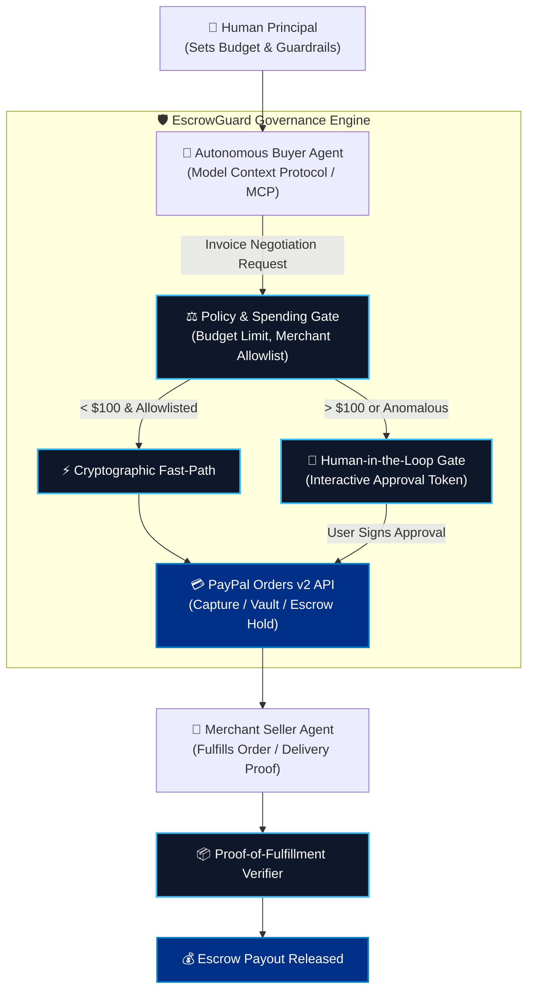

# 💳 PayAgent Core — Autonomous Agentic Commerce & EscrowGuard Protocol

> **Built for the [PayPal AI Hackathon 2026 (Devpost)](https://devpost.com)**  
> *Timeline: October 1 – November 12, 2026 • Prize Pool: $67,500*

PayAgent Core is an autonomous Agent-to-Agent (A2A) commerce execution and escrow governance protocol. It empowers AI buyer agents to discover, negotiate, and purchase goods or services via PayPal APIs while enforcing cryptographic spend guardrails, cryptographic budget caps, dynamic invoice verification, and Human-in-the-Loop (HITL) approval for high-value transactions.

---

## 🏛️ System Architecture

---

## 🚀 Key Innovations
1. **Agent-to-Agent (A2A) Dynamic Negotiation**: Autonomous buyer and seller agents negotiate volume discounts and item specs over standard MCP protocols.
2. **Deterministic Spending Caps**: AI models propose purchases, but deterministic code cryptographically enforces policy gates before a single dollar can move.
3. **Escrow Hold & Proof-of-Delivery Verification**: Funds are captured into escrow and only settled once the buyer agent cryptographically verifies the fulfillment receipt.
